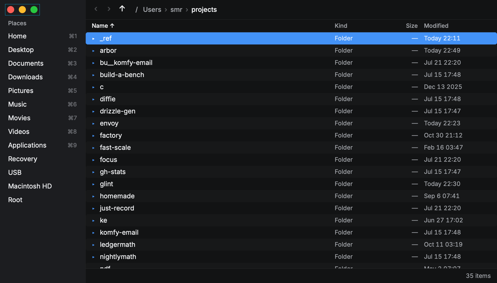

# Arbor

A small, fast file manager for macOS, Linux and Windows, built on [Rune](https://github.com/anomalyco/rune)
(native GPU UI in Rust).



## Design rules

- **No caching.** Every navigation reads the folder fresh. There's no index, thumbnail store or
  prefetch. It's fast because it does very little work.
- **One read per navigation.** It runs `read_dir` plus one `lstat` per entry on a worker
  (`rune::Latest`), so a slow or network disk never freezes the window. The newest request wins,
  and the old listing stays on screen until the new one arrives, so there's no blank flash.
- **Build only what's visible.** Rows are `virtual_rows`: a 50k-file folder lays out about 30 rows.
- **No animation.** Every change lands with `tx.instant()`.
- **Idle means idle.** No timers and no polling. Nothing redraws until you do something.

- **File operations never block and never overwrite.** Copies and moves run on a worker with
  progress in the status bar (Esc cancels). A name that's taken gets a free one instead:
  "name copy" in the same folder, "name 2" elsewhere. Every move and rename is an atomic
  "rename unless the name is taken" (`renameat2(RENAME_NOREPLACE)` on Linux,
  `renamex_np(RENAME_EXCL)` on macOS, `MoveFileExW` without replace on Windows), and copies
  create each file and folder exclusively, so a name another app takes at the same instant is
  never replaced (`src/noclobber.rs`). A case-only rename (`a.txt` to `A.txt` on a
  case-insensitive disk) that the no-replace rename refuses takes two such steps through a
  temporary name. On a disk without a no-replace rename, files move by hard link and folders
  can't be moved or renamed at all, since every way to do it there could replace an empty folder. On APFS, copies are clones (instant). A move to another
  disk copies, then removes only the originals that haven't changed since they were copied.
  Each source's identity is taken when a copy, move or trash begins and checked again right
  before that item is acted on: one replaced or removed while an earlier one was being handled
  is left alone, and the status bar says so.
  A cancelled or failed copy removes what it made, each file known by the handle that wrote
  it, so a file another app put at the name meanwhile (a copy can stall on a slow source) stays
  and the status bar says so.
- **Undo refuses rather than guesses.** When an operation finishes, each result gets a
  fingerprint: identity (device and inode; volume and file id on Windows), type, size and
  modified time. For copies and new folders, which undo sends to the Trash, it also covers
  everything inside. Before undoing, the worker re-checks every item. If anything was moved,
  deleted, replaced or edited, or its spot is taken, nothing is undone and the status bar says
  which item changed and how. Each item is checked again right before it goes back, and one
  whose spot is taken in between stays where it is. A refused or failed undo stays on the
  stack. A partly failed one keeps only what didn't go back; an undo across disks that copied
  an item back but couldn't remove all of the original says where both halves are, and undoing
  again finishes the job if neither has changed.
- **Redo** (⇧⌘Z; Ctrl+Shift+Z, and Ctrl+Y on Windows) puts back what ⌘Z undid. Undoing an
  operation records its reverse, fingerprinted the same way as the disk was left after the
  undo: a move or rename goes forward again, a copy, duplicate or new folder comes back out of
  the Trash (from where the Trash put it), and a trashed item goes to the Trash again. A redo
  refuses on the same terms as an undo, stays on the redo stack when refused, and a redone
  operation can be undone again. A batch rename's undo and redo go through the same plan both
  ways (swaps included). Any new operation clears what could be redone. On Windows the Recycle
  Bin doesn't say where it put an item, so an undone copy or new folder can't be redone there.
- **Known limit:** contents aren't hashed (too slow for big files), so an edit that keeps a
  file's size and leaves its modified time unchanged isn't seen. That includes an edit within
  the disk's timestamp granularity (2 s on FAT, 1 s on HFS+ and ext3; ext4 and NTFS stamp from
  a clock that ticks every few milliseconds).

About 33,500 lines of Rust in `src/`, over a third of it tests. [`ARCHITECTURE.md`](ARCHITECTURE.md)
maps the modules, the threads, the patterns they share and where platform code lives.

## Install

`scripts/package.sh` builds the package for the platform it runs on into `dist/`, and CI builds
all three on every push to `main`: they're the run's artifacts (`arbor-macOS`, `arbor-Linux`,
`arbor-Windows`). A tag starting with `v` also publishes them as a GitHub Release.

- **macOS** (Apple silicon, macOS 11 or later): unzip `Arbor-<version>-macos-arm64.zip` and move
  `Arbor.app` to Applications. It's signed ad hoc, not notarized (that needs an Apple Developer
  account), so the first time, right-click it, choose Open, and Open again (or run
  `xattr -d com.apple.quarantine /Applications/Arbor.app`). Finder then lists it under "Open
  With" for folders.
- **Windows** (x64): unzip `arbor-<version>-windows-x86_64.zip` into a folder that stays put
  (`%LOCALAPPDATA%\Arbor`, say) and run `arbor.exe`. It isn't signed, so SmartScreen may say
  "Windows protected your PC": choose More info, then Run anyway.
- **Linux** (x86-64): `tar xzf arbor-<version>-linux-x86_64.tar.gz`, then `./install.sh` in the
  folder it made. It installs for you only, no root: `~/.local/bin/arbor`, `arbor.desktop` in
  `~/.local/share/applications` (so menus list it) and its icons (the desktop file names the
  binary by its full path, quoted as the Desktop Entry spec says, so any home folder works).
  `./uninstall.sh` removes them, putting back the folder default first if Arbor has it: with
  the installed Arbor, or the one beside the script if that's gone, or with neither, by putting
  back the D-Bus activation file and folder default the backup recorded itself (or removing
  Arbor's when there was none) and saying what it did; a damaged backup stops it before
  anything changes, and the backup stays until everything is back. Running under X11 needs
  `libxkbcommon-x11` (see [Platform notes](#platform-notes)).

Installing never makes Arbor the default for anything. That's a command:

### Make Arbor the default for folders

**"Make Arbor the Default for Folders…"** (in the palette) has other apps open folders in Arbor,
and **"Restore the System Default for Folders…"** undoes it. Both ask first, in Arbor's dialog,
saying what changes and how to undo it. Before the first change, whatever it replaces is saved in
`folder-handler-backup.txt` beside the settings file, and flushed to the disk before anything is
changed: if it can't be saved, nothing changes. A change that fails halfway (a registry write
refused, say) puts back what it had written and says nothing was changed; on Windows the
commands are written before what makes them the default, so a default never points at a
missing command. Restore puts exactly the backup back, but only where the setting is still
Arbor's (anything changed since is left alone, and the status bar says so), then deletes the
backup. Without a backup, Restore still takes back what Arbor wrote; a backup that's empty,
cut short or missing an entry is refused, and nothing changes.
`arbor --restore-folder-default` does the same without opening a window (the uninstall script
runs it).

Folders other apps send open in the running Arbor where the platform passes them to it (macOS,
Linux through D-Bus, and Windows through a named pipe: a second `arbor.exe <folder>` hands the
folder to the first and exits before opening a window): each in a new tab of the active pane,
or, when Arbor was started for it and nobody has used the window yet, in its first tab. "Show
item" requests open the item's folder with the item selected. On Windows, `arbor.exe` without a
folder still opens a window of its own, and two started at the same instant may both open. A
running Arbor that doesn't answer within a second (hung, say) doesn't hold the new one up: it
opens its own window.

- **macOS:** LaunchServices' viewer for folders (`public.folder`) becomes `gg.smr.arbor`, which
  only works from `Arbor.app` (the bare program says so). Restore sets back the viewer you had
  chosen, or Finder: LaunchServices' answer when nobody chose one is a guess among apps that
  declare folders (Archive Utility on the Mac here), so that isn't kept. In Arbor: `open ~/dir`,
  Open With, and apps that open a folder through macOS. **Still Finder** (macOS doesn't let
  another app take these): double-clicking in Finder and on the desktop, the Dock's folders,
  "Show in Finder" or "Reveal in Finder" from other apps (`activateFileViewerSelectingURLs`),
  and Arbor's own Show in Finder.
- **Linux:** `inode/directory=arbor.desktop` in `~/.config/mimeapps.list` (the freedesktop.org
  file `xdg-mime` and `gio` write), and a D-Bus activation file,
  `~/.local/share/dbus-1/services/org.freedesktop.FileManager1.service`, after which the session
  bus is asked to reload. In Arbor: `xdg-open` and `gio open` on a folder, and "Show in folder"
  (or "Open containing folder") in browsers, editors and other apps that ask
  `org.freedesktop.FileManager1` (ShowFolders, ShowItems; ShowItemProperties selects the item,
  since Arbor has no properties window). While Arbor runs it owns that name and opens a tab
  (from the moment Make succeeds, and it lets the name go when Restore does); when it doesn't
  run, the bus starts it. **Limits:** a desktop's own list (`gnome-mimeapps.list`, say)
  wins over `mimeapps.list` (Make says so when it finds one); a file manager already running
  that holds the D-Bus name and won't give it up (Nautilus running in the background on GNOME)
  keeps it until it exits; `xdg-open` on a folder starts a new Arbor window rather than a tab; and
  Arbor's own Show in File Manager opens the default, Arbor itself once it is.
- **Windows:** under `HKEY_CURRENT_USER\Software\Classes` only (no administrator rights, no
  other accounts): folders (`Directory`) and drives (`Drive`) get an "Open in Arbor" verb as
  their default (`"arbor.exe" "%1"`), and Win+E runs Arbor (This PC's `opennewwindow` verb, with
  an empty `DelegateExecute`), as Explorer replacements do. Not the `Folder` class: it also
  covers Control Panel, the Recycle Bin and other virtual folders Arbor can't show. Restore
  writes every saved value back exactly, type included, and removes the keys Arbor made once
  they're empty. In Arbor: opening a folder or drive in Explorer or on the desktop, Win+E, and
  apps that open a folder through the shell; with Arbor already running, each opens as a new
  tab there (below). **Still Explorer:** "Show in folder" from apps that call `SHOpenFolderAndSelectItems`,
  Explorer's own navigation pane, and Arbor's own Show in Explorer. Moving or deleting `arbor.exe`
  while it's the default stops folders opening: restore first. Never run on a real Windows machine
  yet; CI writes and restores the same plan under a test-only key.

## Run

```sh
cargo run --release                 # opens the current dir (or ~ when launched from /)
cargo run --release -- ~/Downloads  # open a folder
cargo build --profile dist          # stripped, LTO build: target/dist/arbor
```

Builds are fully offline. Dependencies are vendored in `vendor/` (see `.cargo/config.toml`).
`vendor/` is gitignored because it's about 550 MB, so a fresh clone runs `scripts/vendor.sh` first.
`scripts/package.sh` makes the package (see [Install](#install)). The icon is drawn by
`scripts/icon.py` (an original tree glyph; pure Python) into `assets/icon/`, and
`scripts/package.sh --icns` turns it into `Arbor.icns` on a Mac. On Windows, `build.rs` writes
the icon and version information into a resource file the linker takes (no resource compiler,
no extra crate). Release builds on Windows are windowed programs, so no console opens with them.
`scripts/vendor.sh` refreshes them through a fast remote machine (default `smr@tabot-dev`) and
syncs them back. When it runs on that machine itself (or with `HOST=local`) it skips ssh. Rune's
commit is pinned in `RUNE_REV`; `REV=origin/dev scripts/vendor.sh` moves the pin.

CI (`.github/workflows/ci.yml`) runs on every push and pull request on macOS, Linux and Windows:
`cargo build --release --locked`, `cargo test --release --locked` and `cargo clippy -D warnings`,
plus `cargo fmt --check` on Linux, then builds, checks and uploads each package. It clones Rune at `RUNE_REV` and gets crates from crates.io
instead of `vendor/`.

## Measuring speed

`ARBOR_TIMING=1 arbor` logs to stderr how long the first frame took from `main`, each key press
to its frame, and each navigation to the frame showing the new listing (`src/timing.rs`). The
window waits at most 8 ms for the first folder; when it's slower, the listing's own frame is
logged as `first-listing`, and `ARBOR_SLOW_FIRST_READ_MS=N` (timing only) slows that read to try
it. All times end at frame submission, a proxy: pixels reach the screen at least a refresh later. Off,
it costs nothing: `main` reads the variable once and Rune gets the plain callbacks and no frame
hook. Showing a hidden tab is logged as `tab`, with `same_frame=1` when its fresh read landed
in time for the key's own frame. `scripts/bench.sh` cold-starts Arbor on a 10,000-entry folder
several times and reports median and p95 against each budget (`--tabs N` adds N runs timing a
tab switch to that folder, and `--preview N` adds N runs timing the quick preview of a 256 KB
text file and a 12 MP JPEG from Space to the frame showing it, and keys while it's open, and
`--search N` adds N runs searching a 120,000-file tree: the key to the first results and to the
end of the walk, and keys pressed while results stream in, and `--rename N` adds N runs typing
in Batch Rename over 10,000 items: each key to the frame showing its preview; `--pace MS` spaces
the steps as a person types and `--gap MS` idles between cold starts, since a cooled CPU is
several times slower than a busy one: report both). It opens and closes windows, so leave the machine alone
while it runs. `cargo test --release -- --ignored --nocapture list_10k` times reading and
sorting alone. Results are in [`BENCH.md`](BENCH.md).

## Keys and the command palette

Every action is a command with an id, a title and default keys, in one table
(`src/commands.rs`). Keys, the palette, the context menu and the settings file all read it.

**⌘K** (or **⇧⌘P**) opens the command palette: type part of a command's name, see its keys,
press Enter (or click) to run it. ↑↓ and Page Up/Down move, Esc or a click outside closes it.
Matches that start the name, then ones that start a word, come first; initials work too ("nf"
for New Folder), and so do ids once you type a `.` ("file.tr"). Commands that can't run right
now (Rename with nothing selected) are dimmed, and choosing one says why.

Typing, outside the palette:

- **Type anything** to filter the folder. The first name starting with what you typed gets
  selected. While the filter has text, typing, ⌫ and ⌥⌫ edit it.
- **Type `/` or `~`** (or ⌘L) for go-to-path mode. Enter navigates, or opens a file. **Tab**
  completes the last part of the path against what's in its folder: the first Tab as far as
  every match agrees (all of a single match, with a `/` after a folder) and, with several, lists
  them in a small card over the status bar; Tab again cycles through them, ⇧Tab backwards (each
  Tab reads the folder again, so a name removed meanwhile is skipped and a new one joins).
  Typing anything else carries on from there. Capitals count on Linux and don't on macOS and
  Windows; hidden items are matches while hidden files are shown, or once you type a dot. The
  folder is read fresh on a worker for each completion (no cache), and the key waits at most a
  frame for it; a slower folder completes when it answers, unless you've typed on.
- **Space** with nothing typed opens or closes the quick preview (below). While the filter has
  text, Space types a space, since names have spaces; a filter never starts with one.
- Tab switches to the other pane (in go-to mode it completes the path, above).

Off macOS, ⌘ is Ctrl. Mouse: click to select, ⇧-click and ⌘-click to select several,
double-click to open, click a breadcrumb or place to jump there (in a narrow pane the
leading folders fold into “…”, which opens the deepest hidden one), click a column header to sort
(click again to reverse). Right-click opens a context menu: native on macOS and Windows, and on
Linux, where Rune has none, Arbor's own in the window with the same items (↑↓, Home, End or a
letter move, Enter or Space runs, Esc or a click outside closes; see `RUNE-GAPS.md`). Drag rows
out to Finder or other apps (macOS). Drop files on a folder row or on the list: same disk moves,
another disk copies, and ⌥ forces a copy.

### Tabs and split view

**⌘\\** splits the window into two panes side by side, the new one on the same folder (and
active); ⌘\ again closes the other pane. Each pane has its own **tabs**: **⌘T** opens one on the
current folder, **⌘W** closes it, **⌃Tab** / **⌃⇧Tab** (or ⇧⌘] / ⇧⌘[) go to the next and previous,
**⇧⌘T** reopens the last closed one. Each tab has its own folder, back and forward history,
selection, scroll, filter and sort. The tab bar appears only when a pane has two or more tabs:
click a tab to show it, middle-click to close it, hover for its full path, "+" for a new one.
When they don't all fit, the bar shows the tabs around the active one, with "‹ 3" and "5 ›"
for how many are hidden on each side (click one to show the nearest).

One pane is **active**: it gets the keys, the palette's commands and the status bar, and in a
split window it has a thin accent line along its top and the accent-coloured selection (the
other pane's selection is grey). **Tab** or a click anywhere in a pane makes it active. The
sidebar drives the active pane. File operations stay global: one at a time, one undo stack, one
clipboard. **F5** copies and **F6** moves the selection into the other pane's folder (on a
worker, never over anything, undoable), and rows can be dragged from one pane onto the other
(same disk moves, another copies, ⌥ copies).

Closing a split pane's last tab closes that pane. On the last tab of the last pane, ⌘W does
nothing, on every platform: closing the window would quit Arbor and lose every tab's history,
which a habit of pressing ⌘W to tidy tabs shouldn't do. The window's close button still closes
it.

No caching: only the visible tab of each pane has a listing. A hidden tab keeps its path,
history, selected names, scroll offset, filter and sort, and does no work at all (no reads, no
watching). Showing it reads its folder fresh, waiting at most 8 ms so a local folder lands in
the same frame; a slower one shows the tab's path and an empty list until it arrives. The
selection comes back by name and the list scrolls to where it was. ⌘T and ⌘\ show the folder
already on screen, so they need no read. Closed tabs (up to 20, lightweight state only) are kept
in memory for ⇧⌘T, never on disk.

### The sidebar: favorites and Locations

The sidebar lists **Favorites**, in your order, then **Locations**, the volumes mounted now.
⌘1–9 go to the first nine (favorites first), and so do "Go to …" in the palette.

- **Favorites** start as the usual folders (Home, Desktop, Documents, Downloads, Pictures,
  Music, Movies or Videos, Applications on macOS, and the root outside Windows), or the
  settings file's `places`. **"Add to Sidebar"** (palette, or a right-click on a folder or on
  empty space) adds the selected folders, or the folder on screen; dropping folders on the
  sidebar from another app, or dragging rows there from the list, adds them too (on macOS,
  rows dragged from the list go out to other apps unless the window is split; see
  `RUNE-GAPS.md`). Right-click a favorite for **Open**, **Open in New Tab**, **Remove from
  Sidebar** (the folder itself stays), **Move Up** and **Move Down**; or drag it up or down
  the list. "Remove from Sidebar" in the palette removes the folder on screen.
- The list is yours (user data, not a cache), kept in `sidebar.toml` beside the settings file
  (not in `config.toml`, which is for editing by hand). It's read at startup by the thread that
  reads the first folder, never the window's, and written by a thread of its own after each
  change (a temporary file renamed over the old one; several changes in a row are written
  once; quitting gives it up to 100 ms). Each change is applied to the file as it is then,
  holding its lock file (`sidebar.lock`), so two Arbor windows keep each other's changes,
  and each shows the other's after its own next change. A failed write shows in the status bar. A file that
  can't be read gives the default list and says so; the next change replaces it. Delete the
  file to go back to the defaults; while it exists, the settings' `places` are left alone.
- **A favorite that isn't there any more** is dimmed, and clicking it says so instead of going
  there. Each favorite is looked at once per launch, after the window is up, on a worker of its
  own (a dead network folder holds up only its own look), never again until the next launch,
  and never watched. One that vanishes later is marked when a click finds it gone.
- **Locations**: on macOS what's mounted in `/Volumes` (not the boot volume's alias, or a
  folder left there with nothing mounted); on Linux the mounts under `/media/$USER`,
  `/run/media/$USER`, `/media` and `/mnt` from `/proc/self/mounts` (not the kernel's own file
  systems); on Windows the drive letters, with each drive's label (not asked of network drives,
  which can take seconds when disconnected). They're read on a worker once the first frame is
  up, and again only when asked: opening a sidebar item's menu, ⌘R, after an eject, and when
  the OS says a volume came or went, where it can without polling (macOS's mount
  notifications; Windows' `WM_DEVICECHANGE`, through a hidden window of Arbor's own). Linux
  has no such notification short of watching, so there it's a right-click or ⌘R.
- **Eject** (⏏ beside the volume, its menu, or ⌘E for the volume the active pane is on): a pane
  showing the volume goes to the home folder first, then it runs on a worker and says how it
  went: "Ejected “USB”", or "“USB” is in use by another app, so it wasn't ejected". macOS asks
  NSWorkspace (`unmountAndEjectDeviceAtURL:`); Linux runs `udisksctl unmount`, then `power-off`
  (or `gio mount -e` when udisks isn't there); Windows locks, dismounts and ejects the volume
  (`DeviceIoControl`), which fails while another app has a file open on it. Offered for
  removable drives and discs on Windows, everything in `/Volumes` on macOS (an internal disk's
  other volumes refuse, and say so), and udisks' mounts under `/media` and `/run/media` on
  Linux (a mount in `/mnt` needs root to unmount).

### Quick preview

**Space** opens a panel showing the active pane's selected item; Space again or **Esc** closes
it. With one pane it docks on the right and the list stays usable beside it: ↑↓ (or a click)
move the selection and the preview follows. In a split window it takes the other pane's place,
as a two-panel commander's quick view does (Tab swaps which pane shows; F5 and F6 still copy and
move into the covered pane's folder). Esc closes the palette first, then the preview, then
clears the filter or cancels a file operation.

- **Text** (found by its bytes, not its name: few NULs and control characters; UTF-8, UTF-16
  with a byte order mark, or other 8-bit text, which is read as Windows-1252, the superset of
  Latin-1 that Windows writes, and the panel says "Shown as Windows-1252"): the first 256 KB in
  the system's monospaced font, no wrapping (scroll sideways), lines over 1,000 characters cut.
  The panel says when it's showing only the start, and when UTF-8 has a few invalid bytes (they
  show as �). Only the lines in view are laid out.
- **Images**: PNG, JPEG, GIF (its first frame), WebP and BMP, also found by their bytes. Decoded
  on a worker and shrunk to the panel's size in pixels before they're uploaded: a PNG shrinks row
  by row as it decodes, and a JPEG decodes at 1/2, 1/4 or 1/8 size straight from its DCT. JPEGs
  are turned as their EXIF orientation says. A GIF decodes 16 rows at a time, shrinking as
  they come, and stops at the next 16 when you move on (under a millisecond after a 24 MP GIF
  is told to stop). The header gives the size first, and anything over 100 megapixels (24 for
  BMP, interlaced PNG and GIF, and progressive JPEG, which decode whole first), or wider or
  taller than 65,535 pixels, is refused with a "Too large to preview" card, so a huge image
  never takes gigabytes. WebP can't be stopped once it starts decoding (its decoder has no way
  to), so it's held to 4 megapixels (lossy, lossless and animated): a decode you've moved on
  from still runs to the end on the preview's thread, up to about 0.6 s for the worst 4 MP image
  here (random pixels with alpha, on a busy machine; a photo-like one under 0.1 s), and its result is dropped. That's an
  exception to the "cancels it immediately" rule, signed off by the owner (NORTHSTAR.md). Larger
  ones say "Too large to preview", and so does a JPEG with over 16 MB of metadata (its markers
  are walked before it's decoded); a WebP's bitstreams are checked against its canvas before
  decoding.
- **PDF, video, audio, office and iWork documents, fonts, HEIC, TIFF, RAW, and any other file
  that isn't text or one of the images above**: the OS's own thumbnail, sized to the panel in
  device pixels, shown like an image under the same header (`src/thumb.rs`). Video shows a still
  frame and audio its artwork, whatever the OS's thumbnailer gives; nothing plays. Arbor stores
  nothing; the OS may keep what it makes in its own thumbnail cache, the one Finder and Explorer
  fill. When the OS has nothing (a broken file, nothing that reads it), the card says "Can't
  preview this file", never a blank panel; a request that hasn't answered in 10 s is cancelled
  and gets the same card.
  - **macOS:** Quick Look (`QLThumbnailGenerator`), asked for its best thumbnail (never a
    generic icon). Moving on or closing calls `cancelRequest:` at once, and a late answer is
    dropped.
  - **Windows:** the shell's thumbnails (`IShellItemImageFactory`), **only those the shell has
    already cached** (what Explorer made when it showed the folder), which come back at once.
    Making a new one can't be cancelled once it starts, so it's off until the owner decides on a
    NORTHSTAR exception: `UNCANCELLABLE_WINDOWS_THUMBNAILS` in `src/thumb.rs` (a build-time
    flag, `false`) turns it on, after the cache is asked.
  - **Linux:** none. Its thumbnailers keep a thumbnail cache, and Arbor keeps no caches, so the
    card says there's no preview for these formats.
- **Everything else**, and folders: name, kind, size and date, and for a folder how many items
  it has (one read of it).
- A link previews what it points to and says where; a broken link, an unreadable file, or a
  pipe or device (never opened: reading a pipe would wait forever) says so. A file swapped for a
  pipe after that check is still never waited on: the open doesn't block, and the opened
  file's own type is checked before anything is read.

It costs nothing while closed: no reads, no decoding, nothing per key. Open, it's background
work that follows the rules for it: the list moves at once and the header (from the listing)
changes in the same frame, then the contents land when they're read. Moving on or closing stops
the read in flight (every read call and decoded row checks) and its result is dropped. One read
per item, no watching, nothing kept: coming back to a file reads it again. A Quick Look request
is waited on by that thread, which the stop wakes at once (no polling), so it's cancelled the
moment you move on. All of it runs on one
thread of its own, started by the first preview and kept across opens, one read or decode at a
time: tapping Space quickly queues at most one more (each new request replaces the one
waiting), so decodes never pile up, and a slow or hung disk slows previews, never the list or
other folders.

### Get Info

**⌘I** (or "Get Info" in the context menu) opens a panel where the quick preview goes (Space
switches to the preview, ⌘I or Esc closes it), following the selection as the preview does.
For one item: its name, kind, full path (selectable, and "Copy Path"), size in bytes, when it
was created, modified and last opened, its permissions as `ls -l` writes them and owner (macOS,
Linux) or its attributes (Windows: Read-only, Hidden, System…), and where a link points.
"Rename…" starts the list's own rename (undoable). With nothing selected it's the folder on
screen; with several items, how many files and folders and their total.

**A folder's size and item count** (or the total of several items) are counted on demand,
following NORTHSTAR's rules for view-triggered work: the panel shows at once with what the
listing knows, the item's own details land from a worker a moment later, and the count streams
in ("7,041 items · 414 MB so far…") on a thread of its own that wakes the window at most every
30 ms. Moving the selection or closing the panel stops it at the next entry. It never follows
links, never enters another file system mounted inside (as Delete Permanently tells them apart:
the device, and on macOS the volume) and says how many it left out, counts folders it couldn't
read instead of guessing, and keeps nothing: come back and it counts again. Sizes are the files'
own lengths (a hard-linked file counts each time, as Finder does).

Changing attributes (hidden, read-only) isn't offered: it couldn't be undone.

### Open With

**"Open With…"** (palette, or the context menu on a file) lists the apps that can open the
selected files, the default first; ↑↓ and Enter (or a click) opens them all with that app, Esc
closes. The list is read on a worker when Open With opens and dropped when it closes; opening
runs off the window's thread too.

- **macOS:** Launch Services' list (`URLsForApplicationsToOpenURL:`, or
  `LSCopyApplicationURLsForURL` before macOS 12), the default from
  `URLForApplicationToOpenURL:`; the context menu has an **Open With** submenu when the list is
  read within a frame of the right-click (a native menu can't change once open), and "Open
  With…" otherwise. Opening runs `open -a`. There's no "Other…" to pick any app yet (see
  `DECISIONS.md`).
- **Linux:** the file's MIME type from `xdg-mime query filetype` when it's installed, otherwise
  from its name through the shared MIME database's `globs2` (and a look at its first bytes for
  text); then the freedesktop.org associations: every `mimeapps.list` in the spec's order (its
  defaults, added and removed associations), each applications folder's `mimeinfo.cache` (or its
  `.desktop` files where there's none), and each app's `.desktop` file for its name (translated
  for `$LANG`) and `Exec` line, whose field codes are filled in (`%f` runs it once per file).
  Any text file also lists the apps for plain text.
- **Windows:** the system's own Open With dialog (`SHOpenWithDialog`), which lists the apps with
  the default first and lets you choose any other.

### Jump to Folder

**⌘J** opens a box over the window. Type parts of a folder's path and it ranks the folders
you've been to, best first, with the matched letters in bold; ↑↓ move, Enter (or a click) goes
there in the active pane, Esc closes. Each word must appear in the path in order, case aside,
and the last word should be in the folder's own name: "proj arb" finds `~/projects/arbor`
before `~/projects/arbor/src`. Among matches, folders you go to often and lately come first
(frecency, as zoxide does: every visit adds 1, weighted ×4 within the hour, ×2 within the day,
×½ within the week, ×¼ after; when the total passes 10,000, all shrink to 90% and folders
under 1 are forgotten). Typing a path (`/…`, `~/…`, or `C:\…` on Windows) works as go-to does:
Enter goes there, and the folders below it you've visited are listed under it.

The history is user data, kept in `history.log` beside the settings file, and costs nothing
until Jump opens:

- Each navigation that lands (opening a folder, back, forward, a sidebar place, Jump itself;
  not reloads or tab switches) sends its folder to one writer thread, which appends a line.
  The window does no disk I/O for it, and nothing is read at startup. A write that fails (a
  full disk, a read-only folder) shows in the status bar. The writer holds a lock file
  (`history.lock`) while it appends, compacts or clears, so two Arbor processes never lose each
  other's visits, and quitting gives it up to 100 ms to finish what's queued.
- The first time Jump opens, the writer reads and adds up the log. The box waits at most 8 ms
  for it, then says "Loading history…" until it lands. It then stays in memory for the session.
  Past 10,000 lines the writer rewrites the log as one line for each of the top 5,000 folders.
- Nothing checks that the folders still exist. Going to one that's gone says so and forgets it.
- `[jump] enabled = false` stops recording and reading it (and Jump says it's off);
  `[jump] exclude` lists globs of folders never recorded. "Clear Jump History…" forgets it all.
  It can't be undone, so it asks first, in Arbor's one dialog (only for actions that can't be
  undone): it says so plainly, and Cancel has the focus, so Enter (or Esc, or a click outside)
  cancels. Tab or ← → moves to "Clear History", and Enter (or a click on it) clears. Starting
  with Cancel means an Enter pressed twice, or out of habit, can't destroy anything.

### Select by Pattern

**⌘S** opens a small box: type a glob and it counts the matches as you type ("14 of 27
match") without changing the selection. **Enter** selects the matches, **⇧Enter** adds them to
the selection, **⌥Enter** takes them out. `*` is any run of characters, `?` one, `[abc]`,
`[a-z]` and `[!abc]` one from (or not from) a set, and `{png,jpg}` either; a name has to match
whole (`IMG_*`, `*.jpg`, `*.{png,jpg}`). It matches the rows on screen: hidden files only while
they're shown, and only what the filter lets through. Capitals count on Linux and don't on macOS
and Windows, as their usual file systems do; `[select] case_sensitive` changes that (the box
shows "Aa" or "aA"). Glob only for now: regular expressions (regex-lite, which Batch Rename
uses) take 20–40 ms to test 50,000 names here against about 1 ms for a glob, over a frame a
key, so `re:` waits until the count runs off the UI thread.
**⇧⌘I** inverts the selection, and "Select All of This Kind" (palette) selects every row with
the cursor row's extension (or every folder). The selection is a set of names, so a listing that
refreshes keeps it.

### Batch Rename

With two or more items selected, **F2** (or ⇧⌘R) opens Batch Rename instead of renaming inline,
as Finder does; "Batch Rename…" in the palette opens it for any selection. It works on search
results too: each item is renamed in its own folder.

- **Find**: plain text, every occurrence. **.\*** (⌥R) makes it a regular expression
  (regex-lite: Perl syntax; `\d`, `\w` and case folding are ASCII only). Capitals don't count
  unless **Aa** (⌥C) is on. An empty Find makes Replace the whole new name.
- **Replace with**: text and tokens. `{n}` is the counter (`{n:3}` pads it to 3 digits),
  `{name}` the original name without its extension, `{ext}` the extension without its dot, and
  `{parent}` the item's folder's name. In regex mode `$1`, `${1}` and `${name}` are what a group
  matched (`$$` is a dollar sign; write `${1}x`, since `$1x` names a group "1x"). Anything else
  in braces stays as typed.
- **Number**: the counter starts at Start and goes up by Step (which can be negative) for each
  item Find matches, in the order the items are listed; one it leaves alone takes no number.
- **Case**: Keep, lower, UPPER or Title, applied last.
- **Include extension** (⌥E): off by default, so the extension stays as it is. Folders have no
  extension, and neither has a name like `.bashrc`.

The preview lists every item, old name → new name, updating as you type; rows that don't change
are dim. Problems are red, with why: two items given one name; a name already in the item's
folder (the batch's own old names don't count: those items move); what the platform doesn't
allow (everywhere `/`, NUL, an empty name, `.` and `..`; on Windows also `<>:"\|?*`, control
characters, a trailing dot or space, and CON, PRN, AUX, NUL, COM1–9 and LPT1–9 with or without
an extension); a name over 255 bytes (255 UTF-16 units on Windows); and names that differ only
in case on a disk that ignores case (each folder's disk is asked, by looking up one of its names
with the case swapped). An item inside another item that's being renamed too (search results can be a
folder and something in it) is a problem as well: the folder's rename would move it from under
its own, so rename them separately. A summary says "12 will change · 2 problems". Rename is disabled while
there are problems; Enter renames (every field is one line), Esc or a click outside closes, and
the rule is kept for the next time this session.

Renaming is one file operation on the worker, with progress, and Esc cancels it:

- Before anything moves, every item is checked against the fingerprint taken when the dialog
  opened (identity, type, size, modified time), and every new name must be free or be the old
  name of another item in the batch. Otherwise nothing is renamed, and the status bar says
  which item and why.
- Swaps and chains (a → b and b → a; a → b and b → c) work: an item whose new name is another
  item's old one (or its own in another case) first steps aside to a temporary `.arbor-…` name
  in its folder, the others take their new names, then it takes its own. Every step is a
  no-replace rename (`src/noclobber.rs`).
- Each item is checked against that fingerprint again right before each of its own steps: one
  replaced or edited by another app while the batch runs (a big batch takes a while) is never
  renamed, and the batch is put back, saying which item changed.
- A failure or a cancel midway puts every item back, last step first, again never over
  anything, and only while what's at each new name is still the item that went there. If
  another app took an old name meanwhile, or replaced or edited an item since it was renamed,
  that item stays where it is and the message says exactly where, and how many items got their
  old names back ("1 of 2 items have their old names again; “a.txt” is now “b.txt” in …").
- It's one undo entry: ⌘Z puts every item back through the same plan, and changes nothing if
  any of them changed since.

Afterwards the renamed items are selected under their new names.

It costs nothing until it opens. Opening reads each item's folder once, on a worker (what else
is in it, its case rule, the fingerprints), and waits at most a frame for it with a few items;
with many, Rename waits until it lands. Up to 500 items are previewed on the spot (well under a
millisecond); more on a worker, which each key waits at most 3 ms for: a plain-text change to
10,000 names lands with the key, and a regex over 10,000 names (about 20 ms here) shows the last
preview until the new one lands (Enter then renames once it has). Only the rows in view are
built. Not checked: two names that are the same to APFS only after Unicode normalization (é as
one character or as e and an accent); the no-replace rename still refuses the second, and the
batch is put back.

### Trash and Delete Permanently

**⌘⌫** (or Delete) moves the selection to the Trash (the Recycle Bin on Windows), and ⌘Z puts it
back on macOS and Linux. **A trash never silently becomes a permanent delete.** When an item's
disk has no trash that will take it, it stays where it is, and Arbor asks, in its one dialog,
whether to delete it permanently ("“a.txt” and “b.txt” can't go to the Trash: … Delete them
permanently? This can't be undone."). With several items, those that can go to the trash go
first (that part can be undone as usual), and the rest are gathered into that one question,
since nothing permanent has happened yet and only the disk can say which items it takes.
Cancel has the focus, and Esc keeps them.

- **macOS:** `NSFileManager` puts the item in the Trash, or fails on a disk without one (many
  network shares, some FAT, exFAT and NTFS disks); that failure is the question. A write or
  permission failure (which a disk without a usable Trash also gives, but so do other causes) is
  the question too, with macOS's own reason rather than a claim about the disk.
- **Linux:** the freedesktop.org trash: the home trash (`~/.local/share/Trash`) for items on its
  disk; on another disk its own `$top/.Trash/$uid` (only if `.Trash` is a sticky folder, not a
  link) or `$top/.Trash-$uid` (made if missing). An item is only ever renamed into a trash on its
  own disk, never copied. If neither can be used (a read-only top folder, no permission, a FUSE
  disk that refuses), the question; if the item's own folder can't be changed either, an error,
  since a delete couldn't remove it.
- **Windows:** items on network shares and mapped drives, discs and RAM disks get the question
  without the shell being asked. On a local disk, before the shell is asked, the worker reads the
  Recycle Bin's settings for the item's volume from the registry (`HKCU\…\Explorer\BitBucket\
  Volume\{GUID}`: `NukeOnDelete` and `MaxCapacity`; the parent key's `NukeOnDelete`; the
  `NoRecycleFiles` and `RecycleBinSize` policies, the latter a percentage of the drive) and adds up the item's size (never following
  links, junctions or mounted volumes; Esc stops it). An item the bin wouldn't keep (turned off,
  bigger than the bin, or any of it unknown, as on most removable drives, which have no bin) gets
  the question instead; a removable drive with a bin of its own is used. Then the shell's
  `IFileOperation` recycles each item, and Arbor stops the
  delete before it begins unless the shell says it's about to recycle the item (it doesn't for
  an item too big for the bin, a bin turned off for the drive, or a virtual drive such as
  Cryptomator's or another WinFsp one that doesn't support it). If the shell ever deleted an item
  without putting it in the bin anyway, the status bar says so plainly. Restore from the Recycle
  Bin: Windows doesn't say where an item went, so Arbor can't undo it.

**Delete Permanently…** (⌥⌘⌫ on macOS, as in Finder; Shift+Delete on Windows and Linux, as in
Explorer and Files) always asks first. The dialog names the count and the first few items, says
folders go with everything in them, and that it can't be undone. It runs as a file operation on
the worker, with progress, and Esc cancels it: what's already deleted stays deleted, and the
status bar says how many went and which folder was left partly deleted. A folder it can't
finish (an item it can't remove, a mount, a folder moved meanwhile) stops there and says so
truthfully: "Partly deleted “x”: stopped at “x/y” (permission denied); 12 items deleted, 3 left"
(what's left is counted on the worker; when part of it can't be read, it says "some items left
(count unknown: couldn't read “x/z”)" rather than a number that's too low). There's no undo entry.
Each item is deleted only while it's still the item you chose (its identity from the listing, or
the walk's for search results, checked right before it goes); one replaced or removed since is
left alone and named. It never crosses into another disk: a folder something is mounted on
(a USB disk, a FUSE or network mount, a bind mount; on Linux the mount table is read once per
operation, elsewhere a different device gives it away; on macOS also a different volume, since the
APFS volumes of one group share a device and firmlinks such as `/Users` lead to the Data volume; on Windows a volume mounted in a folder)
is neither entered nor removed, the delete stops there and says "Skipped “x”: another disk is
mounted there", and so does deleting a mount point itself. A move to another disk leaves the
originals of anything mounted inside the moved folder where they are, and says so. Folders go with everything inside, and links are removed, never followed
(on Unix each folder is opened relative to its parent without following links, so one swapped
for a link meanwhile is refused; the folder opened must be the one checked, and before it's
removed its name must still lead to it, so one moved aside and replaced meanwhile is left alone
and named). Unix deletes a read-only file as it is (its folder's
permission is what counts) and reports what it can't remove; Windows clears the read-only
attribute first, as Explorer does.

### Search in This Folder

**⌘F** turns the active tab into a search of its folder and everything inside it: a query field
over the results, which stream in while the folder tree is walked. There's no index: every
search walks again, and nothing is kept once it ends.

- **Matching names** (files and folders): each word is a substring, case aside, unless it has
  a capital (then capitals count: `README`). A word with `*`, `?` or `[` is a glob matching the
  whole name (`*.rs`, `IMG_[0-9]*`), with the same rule for capitals. Several words must all
  match (`report 2024 *.pdf`).
- **Results** show the name, the folder it's in below the search's root (dim), size and date.
  They stay in the order found, shallow folders first, and nothing reshuffles under the pointer;
  click a header to sort them (results found after that join the order when the walk ends).
  The status bar says "Searching… 1,234 found in 18,000 items", then "1,234 found in 52,113
  items · 1.8 s". While the walk goes on, the list holds the first 1,000 results, and the rest
  join when it ends or Esc stops it: Rune reads every row's key again whenever a list grows, so
  a list growing every frame would slow the window in proportion to the results (see
  `RUNE-GAPS.md`).
- **Keys:** typing edits the query; ↑↓ and Page Up/Down move through the results while you
  type; Enter or Tab hands the keys to the results, so Space previews, ⌫ goes back to the query
  and everything else works as in a folder: open, Show in Finder, copy, cut, Move to Trash,
  rename, duplicate, Copy Path, drag, F5 and F6, the context menu, Select by Pattern. Each acts
  on the result's own full path (a rename stays in the item's folder; two `report.txt` in
  different folders are two items). Paste, New Folder and drops onto the list wait until you
  leave the search (where would they go?); a drop onto a folder in the results works.
  Duplicate works on items from one folder at a time.
- **Each result is the item the walk found.** It keeps that item's identity (device and inode,
  from the `lstat` the walk already does; on Windows its creation time, since the file index
  needs the file opened). Move to Trash, cut and paste, copy, F5 and F6, drops, Duplicate,
  Rename and Batch Rename check it first (on the worker for operations, at the spot for an
  inline rename and a drag out to another app), and leave out any item whose path now holds
  something else or nothing, saying so; the rest go ahead. Operations check each item again
  right before acting on it, so one replaced while an earlier one was handled is left alone too. On Windows a file deleted and
  recreated under the same name within 15 seconds keeps the old creation time, so a replacement
  that quick isn't seen there.
- **After a file operation**, the results it could have touched are checked again on a worker
  (not the whole walk): what's gone, or isn't the item the walk found any more, drops; what
  changed updates; and what landed inside the search's root and matches joins. A renamed folder
  takes its results with it. A change made through another path to the same folders (another
  pane on the folder a symlink leads to) is matched by the folders' canonical paths, which the
  operation and the walk each look up on their own threads. While a walk is still going, it
  remembers what operations moved or removed: results it delivers later under a changed path
  (read before the change) are checked again by identity, found where they went, or dropped.
  A newer recheck stops the one in flight and takes over its work; a new query or leaving the
  search stops it too.
- **Esc** stops a walk that's still going, keeping what it found; Esc again (or Back, ⌘[, or
  clearing the query) goes back to the folder, read fresh, with its selection, scroll and filter
  as they were. Opening a folder in the results goes there (Back comes back to the folder). A
  tab hidden while searching keeps only its query, and searches again when it's shown.
- **The walk** runs on a few threads of the window's own (at most four), started by its first
  search, kept, and idle between searches, below the window's priority (nice 10 and the lowest
  disk priority on Linux, the utility class on macOS, below normal on Windows). They share one queue of folders and check a stop flag
  before every entry, so a new query, Esc, navigating, or hiding or closing the tab stops the
  old walk at once. Starting one touches no disk on the window's thread: the root's device and
  canonical path are looked up by the thread that reads it. What they find goes into one shared
  batch (a big folder hands its matches over 256 at a time while it's read), and the window
  takes it at most once a frame and only appends it, so a slow disk slows the results, never the
  window. It doesn't enter links to folders (no loops), a folder it has already entered by
  another path (a bind mount on the same disk; known by device and inode), hidden folders while
  hidden files are hidden, other file systems mounted inside (`[search] cross_devices = true` to
  search those), or `/proc`, `/sys` and `/dev` on Linux. Folders it can't read are counted ("3
  folders couldn't be read"). It stops at 100,000 results and says so, and stops reading a
  folder as soon as the cap is reached in it. Closing the window stops walks and rechecks
  before the Jump history's last write.

Every command, with its default keys (generated from `src/commands.rs`; a test keeps it in sync,
`ARBOR_WRITE_README=1 cargo test readme` rewrites it):

<!-- commands:start -->
| Command | macOS | Windows, Linux | Id |
| --- | --- | --- | --- |
| Open | ↩, ⌘O, ⌘↓, ⌥↓ | Enter, Ctrl+O, Ctrl+↓, Alt+↓ | `nav.open` |
| Open Folder | → | → | `nav.into` |
| Go to Parent Folder | ←, ⌫, ⌘↑, ⌥↑ | ←, Backspace, Ctrl+↑, Alt+↑ | `nav.parent` |
| Go Back | ⌘[, ⌥← | Ctrl+[, Alt+← | `nav.back` |
| Go Forward | ⌘], ⌥→ | Ctrl+], Alt+→ | `nav.forward` |
| Go to Path… | ⌘L | Ctrl+L | `nav.goto` |
| Jump to Folder… | ⌘J | Ctrl+J | `nav.jump` |
| Search in This Folder… | ⌘F | Ctrl+F | `nav.search` |
| Clear Jump History… |  |  | `nav.clear_jump_history` |
| Reload | ⌘R | Ctrl+R | `nav.reload` |
| Show in Finder / Explorer / file manager | ⌘↩ | Ctrl+Enter | `nav.reveal` |
| Open With… |  |  | `file.open_with` |
| Get Info | ⌘I | Ctrl+I | `file.info` |
| Command Palette | ⌘K, ⇧⌘P | Ctrl+K, Ctrl+Shift+P | `app.palette` |
| Open Settings File | ⌘, | Ctrl+, | `app.settings` |
| Reload Settings |  |  | `app.reload_settings` |
| Make Arbor the Default for Folders… |  |  | `app.make_default` |
| Restore the System Default for Folders… |  |  | `app.restore_default` |
| Clear Filter and Selection | ⎋ | Esc | `app.clear` |
| Copy | ⌘C | Ctrl+C | `file.copy` |
| Cut | ⌘X | Ctrl+X | `file.cut` |
| Paste | ⌘V | Ctrl+V | `file.paste` |
| Move Here (Paste and Move) | ⌥⌘V | Ctrl+Alt+V | `file.paste_move` |
| Copy to Other Pane | F5 | F5 | `file.copy_to_other` |
| Move to Other Pane | F6 | F6 | `file.move_to_other` |
| Copy Path | ⇧⌘C, ⌥⌘C | Ctrl+Shift+C, Ctrl+Alt+C | `file.copy_path` |
| Duplicate | ⌘D | Ctrl+D | `file.duplicate` |
| Rename… | F2, ⇧⌘R | F2, Ctrl+Shift+R | `file.rename` |
| Batch Rename… |  |  | `file.batch_rename` |
| New Folder | ⇧⌘N | Ctrl+Shift+N | `file.new_folder` |
| Move to Trash | ⌘⌫, ⌦ | Ctrl+Backspace, Delete | `file.trash` |
| Delete Permanently… | ⌥⌘⌫ | Shift+Delete | `file.delete` |
| Undo | ⌘Z | Ctrl+Z | `file.undo` |
| Redo | ⇧⌘Z | Ctrl+Shift+Z, Ctrl+Y | `file.redo` |
| Cancel File Operation |  |  | `file.cancel` |
| Move Up | ↑ | ↑ | `select.up` |
| Move Down | ↓ | ↓ | `select.down` |
| Move Up a Page | ⇞ | Page Up | `select.page_up` |
| Move Down a Page | ⇟ | Page Down | `select.page_down` |
| Move to First | ↖ | Home | `select.first` |
| Move to Last | ↘ | End | `select.last` |
| Extend Selection Up | ⇧↑ | Shift+↑ | `select.extend_up` |
| Extend Selection Down | ⇧↓ | Shift+↓ | `select.extend_down` |
| Extend Selection Up a Page | ⇧⇞ | Shift+Page Up | `select.extend_page_up` |
| Extend Selection Down a Page | ⇧⇟ | Shift+Page Down | `select.extend_page_down` |
| Extend Selection to First | ⇧↖ | Shift+Home | `select.extend_first` |
| Extend Selection to Last | ⇧↘ | Shift+End | `select.extend_last` |
| Select All | ⌘A | Ctrl+A | `select.all` |
| Select by Pattern… | ⌘S | Ctrl+S | `select.pattern` |
| Invert Selection | ⇧⌘I | Ctrl+Shift+I | `select.invert` |
| Select All of This Kind |  |  | `select.kind` |
| Show or Hide Hidden Files | ⌘., ⇧⌘. | Ctrl+., Ctrl+Shift+. | `view.hidden` |
| Sort by Name |  |  | `view.sort_name` |
| Sort by Kind |  |  | `view.sort_kind` |
| Sort by Size |  |  | `view.sort_size` |
| Sort by Date Modified |  |  | `view.sort_modified` |
| Reverse Sort Order |  |  | `view.sort_reverse` |
| Quick Preview (Toggle) | Space | Space | `view.preview` |
| Close Preview |  |  | `view.close_preview` |
| New Tab | ⌘T | Ctrl+T | `tab.new` |
| Close Tab | ⌘W | Ctrl+W | `tab.close` |
| Next Tab | ⌃⇥, ⇧⌘] | Ctrl+Tab, Ctrl+Shift+] | `tab.next` |
| Previous Tab | ⌃⇧⇥, ⇧⌘[ | Ctrl+Shift+Tab, Ctrl+Shift+[ | `tab.previous` |
| Reopen Closed Tab | ⇧⌘T | Ctrl+Shift+T | `tab.reopen` |
| Split View (Toggle) | ⌘\ | Ctrl+\ | `pane.split` |
| Switch to Other Pane | ⇥ | Tab | `pane.switch` |
| Add to Sidebar |  |  | `sidebar.add` |
| Remove from Sidebar |  |  | `sidebar.remove` |
| Eject | ⌘E | Ctrl+E | `volume.eject` |
| Go to sidebar place 1…9 | ⌘1 … ⌘9 | Ctrl+1 … Ctrl+9 | `place.1` … `place.9` |
<!-- commands:end -->

Notes: paste copies, or moves what you cut; ⌥⌘V always moves. A paste goes into the folder it
was asked for in, each paste on its own (two asked before the clipboard answers keep their own
folders), and is refused if that folder was moved or replaced before the clipboard answered.
Two panes on one folder by different paths (a symlink to it) are known to be the same folder.
The palette names ⌘\ "Split View" or "Close Split View", and Space "Quick Preview" or "Close
Preview", whichever it will do. Delete Permanently is ⌥⌘⌫ on macOS and Shift+Delete on Windows and
Linux, each platform's own convention. Undo and redo refuse if any item changed since. Ctrl+Y
(redo) is Windows' only; Linux has Ctrl+Shift+Z. ⌘R also reads the sidebar's Locations again. ⌘E ejects the volume the active pane is on; the palette names it ("Eject “USB”"). Add to Sidebar has no key: Finder's ⌃⌘T is ⌘T (New Tab) off macOS, so a settings file shared between machines would clash. Rename selects the name before the extension; Enter saves, Esc cancels. With two or more items selected, Rename opens Batch Rename. Esc also cancels
a running copy or move.

## Accessibility

Rune exposes Arbor's window to each platform's accessibility API through AccessKit
(VoiceOver and Voice Control on macOS, Narrator, NVDA and JAWS on Windows, Orca on Linux), and
Arbor gives every part a role and a name (`src/view/`; `src/a11y_tests.rs` checks the tree):

- **The file list** is a list box named for its folder ("Files in Downloads"). Each row is an
  option named from its cells in reading order (name, kind, size, modified: "notes.txt, txt,
  5 KB, Today 10:30"; a folder says "Folder" when the Kind column is hidden), selected when it
  is, with its place in the whole folder ("2 of 120", not of the rows built). The list's active
  descendant is the cursor's row, so a reader follows ↑↓, typing and every other key. In a
  split window both lists point at the active pane's cursor row.
- **The sidebar** is a list box of places, favorites then volumes (the folder on screen
  selected, ⌘1–9 as each one's shortcut, a volume's ⏏ a button named "Eject …"); **the path bar** a toolbar of named buttons (Go Back, Go Forward, Go to Parent
  Folder, dimmed when they can't) and the breadcrumbs as links; **the tab strip** a tab list
  with the shown tab selected; the column headers say which one sorts and which way.
- **The status bar's note is a live region**: results ("Moved 3 items to the Trash", "Restored
  1 item", "Redid 2 items") are announced when the user is idle, and failures (a refused undo,
  an operation's errors, a folder that can't be read) at once, as alerts. Progress isn't
  announced (it changes many times a second).
- **Overlays** are modal dialogs that keep focus while open and give it back when they close
  (Esc or a click outside): the palette (field "Command"; its options carry their shortcuts,
  unavailable ones are dimmed, the highlighted one is the field's active descendant), Jump,
  Select by Pattern (its count is a status), Batch Rename (named fields, switches for
  regular expressions and capitals, a radio group for case, a checkbox for the extension, the
  summary a status), the in-window context menu on Linux (a menu of items with shortcuts) and
  go-to's completion card. **The confirm dialog** is an alert dialog named by its title and
  described by what it says; the button with the focus (Cancel when it opens) is its active
  descendant.
- **Get Info** is a complementary region named Get Info, the item's name a heading and its
  running total a status; **Open With** a modal list box of apps.
- **The preview** is a complementary region named Preview, the item's name a heading, an image
  named for its file, and a text file's contents a document that Tab reaches; while it has
  focus ↑↓ ←→ scroll three lines, Page Up/Down a page, Home and End to the ends.

**Keyboard only.** Every command is in the palette (⌘K), including those with no key (Sort by
Name, Kind, Size or Date, Batch Rename, Select All of This Kind, Open With, Add to Sidebar…).
Sidebar places are ⌘1–9 and "Go to …" in the palette, ⌘I is Get Info and ⌘E ejects; the breadcrumbs are ⌘↑ (parent) and ⌘L (type a path, Tab completes).
Tab moves focus to the list, the search field and the preview's contents (and switches panes
when the window is split). Focus shows as the selection (the accent colour in the active pane,
grey in the other, with an accent line along the active pane's top), the caret in a field, a
ring on the dialog's focused button, the menu's highlight, and Rune's focus ring on the
preview's contents.

**The tree is built only when a screen reader asks.** Rune builds it only when an assistive
client asks for it (`AccessibilityLink`; until then a frame builds no tree), and Arbor adds no
per-row work for it: rows are named from the text they already draw. What does cost everyone a
little is the roles and labels on the window's chrome, which Rune can't build lazily
(`RUNE-GAPS.md`): about 0.05 ms per key, measured (BENCH.md, milestone 11). The test
`nothing_is_built_until_a_client_asks` checks that nothing is sent before activation and
nothing on an idle frame after it.

**OS settings.** Arbor never animates, so reduce motion changes nothing. Rune doesn't report
increased contrast or a larger text size, so those settings don't change Arbor yet
(`RUNE-GAPS.md`). **Limits** (`RUNE-GAPS.md`): Rune can't move keyboard focus from a handler, so
at launch focus is on the window until the first Tab or click puts it in the list (in a split
window, a click: Tab switches panes); readers aren't told the list allows several selected; a
note identical to the last one isn't announced again. Checked only through the tree Rune
builds (unit tests); no screen reader has been run against it yet.

## Settings

One file holds settings and keybindings. "Open Settings File" (⌘, or from the palette) creates it
with every setting and every command listed, all commented out, and opens it. Nothing watches the
file: run "Reload Settings" after saving (or restart).

| Platform | File |
| --- | --- |
| macOS | `~/Library/Application Support/Arbor/config.toml` |
| Linux | `$XDG_CONFIG_HOME/arbor/config.toml` (default `~/.config/arbor/config.toml`) |
| Windows | `%APPDATA%\Arbor\config.toml` |

```toml
[general]
show_hidden = false        # show hidden files in new windows (⌘. toggles)
sort = "name"              # "name", "kind", "size" or "modified"
sort_descending = false    # default: size and modified sort largest and newest first
start_folder = "~"         # when none is given on the command line
places = ["~", "~/Projects", "/"]   # the sidebar's default favorites (until you change them in Arbor)

[jump]
enabled = true                              # remember visited folders for Jump (⌘J)
exclude = ["/tmp/**", "**/node_modules"]    # never remembered; "dir/**" is dir and all in it

[select]
case_sensitive = false     # Select by Pattern; default true on Linux, false on macOS and Windows

[search]
cross_devices = false      # Search in This Folder also walks file systems mounted inside it

[keys]
"file.trash" = ["cmd+backspace", "delete"]   # replaces the command's default keys
"file.duplicate" = []                        # unbinds it
"app.palette" = ["cmd+p"]
```

In a key, `cmd` is ⌘ on macOS and Ctrl elsewhere; `ctrl`, `alt` (`option`), `shift` and
`super` name those keys. A binding takes its key from any command that had it by default, and if
two lines bind the same key the later one gets it (and the status bar says so). Off macOS
`cmd+g` and `ctrl+g` are the same key. Only `[]` unbinds: a list whose keys are all typos keeps
the defaults. Mistakes never stop Arbor: the status bar shows the first one ("Settings: line 12:
unknown command 'file.trahs' (did you mean 'file.trash'?)"), everything valid still applies, and
the rest keeps its default. A line that isn't valid TOML is skipped. `places` is the sidebar's default list: once you add,
remove or move a favorite, the list lives in `sidebar.toml` beside this file (see
[The sidebar](#the-sidebar-favorites-and-locations)), and `places` waits until that file is
deleted. The file is read at
startup on the thread that reads the first folder, and by Reload Settings on a worker, so it
never holds up the window. Only a regular file up to 1 MB is read; anything else (a folder, a
pipe, a huge file) is reported and ignored.


## Platform notes

All three build, pass tests and pass clippy in CI. How much has been run for real differs:

- **macOS** (main target, used daily): content sits under a transparent titlebar, with the
  traffic lights in the sidebar. The sidebar's Locations are what's mounted in `/Volumes`.
- **Linux**: building needs `libxkbcommon-dev libwayland-dev`. Running under X11 also needs
  `libxkbcommon-x11-0` (desktops have it; minimal installs may not). Opens files with `xdg-open`.
  The sidebar's Locations are the mounts under `/media`, `/run/media` and `/mnt`. Checked at runtime only under Xvfb with Mesa's
  software Vulkan (Ubuntu 24.04): the window opens and lists a folder, and synthetic X key
  presses (XTest) filter, move the selection and drive the command palette and settings reload.
  Under Xvfb too: the in-window context menu, Delete Permanently, and a trash on a disk with no
  usable trash (a folder on `/`, which this user can't write, with the home trash on another
  disk) asking before it deletes. Also under Xvfb, from the tarball installed into a fresh home:
  the desktop file's `Exec` opens the folder, "Make Arbor the Default for Folders…" through the
  palette and its dialog, a ShowItems call starting Arbor through D-Bus activation with the item
  selected, a second call opening a tab in it, and `--restore-folder-default`. Milestone 12 under
  Xvfb: the sidebar with a custom favorite, a missing one dimmed and a Locations entry
  (`/mnt/local`), its context menus, dragging a favorite to reorder (and the file rewritten),
  Open With's list for a text file (Mousepad, Vim), and Get Info for a file and for `/usr`,
  whose total streamed in and matched `find /usr -xdev | wc -l` and `du -sb` exactly. Not
  ejected (nothing removable there). Not yet checked: Wayland, a real GPU, a real keyboard and
  input methods, drag and drop, clipboard, undoing a trash, `xdg-open`.
- **Windows**: drive letters, hidden attribute, Recycle Bin, `explorer /select,`. Compiles and
  passes tests in CI but **has never been run**: everything at runtime is unchecked.
- **macOS packaging**, checked on the M4 Pro: `Arbor.app` passes `plutil -lint` and `codesign
  --verify`, its icon has every size, it launches with `open` and quits, a folder passed at
  launch (`open -a Arbor.app dir`) opens in its first tab, and one sent to the running app opens
  a new tab. Making it the default wasn't tried there (it would change the Mac's real setting);
  the logic is tested with a stand-in for LaunchServices, and reading the current viewer is
  tested for real.

Trash uses NSFileManager on macOS, the freedesktop.org spec on Linux, and the Recycle Bin on
Windows (see [Trash and Delete Permanently](#trash-and-delete-permanently)). Undoing a trash puts
the item back on macOS and Linux (on Linux its `.trashinfo` is removed too). Windows doesn't
report where the item went, so restore it from the Recycle Bin there.

### Test by hand on the Mac

Built, tested and linted on the M4 Pro, but not run there yet (its GUI session was unavailable).
On the Mac, check:

- [ ] Plug in a USB stick: it appears under Locations by itself (the mount notification), and
      the boot volume's "Macintosh HD" alias doesn't.
- [ ] Eject it with ⏏: "Ejected “USB”", and it leaves the list. With a file on it open in
      another app (Preview), Eject says it's in use and nothing is ejected. A disk image
      (`.dmg`) and a network share eject too.
- [ ] With a pane inside the stick, ⌘E ejects it and the pane goes to Home first.
- [ ] Right-click a `.txt` file: the Open With submenu lists TextEdit (default) first and the
      other editors; picking one opens the file in it. "Open With…" from the palette lists the
      same apps.
- [ ] Get Info (⌘I) on `~/Library`: the total streams in, and moving the selection stops it.
      Created and accessed dates show; permissions and owner look like `ls -l`.
- [ ] Add a folder to the sidebar, quit, reopen: it's still there. Drag a favorite up and down.
      Rename the folder in Finder, relaunch: it's dimmed, and a click says it isn't there.

### Test by hand on Windows

CI builds and tests Windows (including a real Recycle Bin trash of a file on `C:` and a refused
one through `\\localhost\C$`), but nobody has run Arbor there. On a real machine, check:

- [ ] Trash a file and a folder on `C:`: they're in the Recycle Bin, and Restore puts them back.
- [ ] Trash on a USB stick: the "Can't Move to the Recycle Bin" question appears; Cancel keeps
      the files, Delete Permanently removes them.
- [ ] Trash on a network share (a mapped drive and a `\\server\share` path): the question.
- [ ] Trash on a Cryptomator or other WinFsp drive: the question, and nothing disappears
      without it (the reported case where Windows deleted for good with no warning).
- [ ] Trash a file bigger than the drive's Recycle Bin limit (Recycle Bin properties, "Custom
      size"): the question, and the file is still there after Cancel.
- [ ] Shift+Delete asks, names the items, and deletes; a read-only file and a folder with a
      junction inside (the junction's target stays) go too.
- [ ] Right-click opens the native menu with the same items as on macOS.
- [ ] With Arbor running, `arbor.exe C:\Users` from a terminal (and a folder opened from
      Explorer once Arbor is the default) opens a tab in the running window, which comes to
      the front, and no second window opens.
- [ ] `arbor.exe` shows its icon in Explorer and the taskbar, and Properties → Details shows
      Arbor and its version; no console window opens with it.
- [ ] Plug in a USB stick: its drive appears under Locations by itself (`WM_DEVICECHANGE`), with
      its label. Eject it (⏏): "Ejected “…”"; with a file on it open in Notepad, it says it's in
      use. A card reader with no card adds no "insert a disk" dialog.
- [ ] Right-click a file → Open With…: Windows' own dialog, with the default app first.
- [ ] Get Info (Ctrl+I) shows attributes (Read-only, Hidden…) and a folder's total.
- [ ] "Make Arbor the Default for Folders…": double-clicking a folder in Explorer, a drive in
      This PC and Win+E open Arbor; "Restore the System Default for Folders…" brings Explorer
      back for all three, and `reg query HKCU\Software\Classes\Directory\shell` is as before.

## Not yet

Emptying the Trash, file watching (use ⌘R), Open With's "Other…" on macOS and Linux, the
sidebar's Locations refreshing by themselves on Linux (right-click or ⌘R), changing attributes
in Get Info, rich previews (PDF, video, documents) on Linux and
new (uncached) thumbnails on Windows (see Quick preview), syntax highlighting in the text
preview, regular expressions in Select by Pattern, more than one operation
at a time, reordering tabs or dragging them between panes, a universal (Intel and Apple silicon) Mac build,
notarized and signed packages, and
dragging rows out to Finder while the window is split on macOS (see `RUNE-GAPS.md`).
